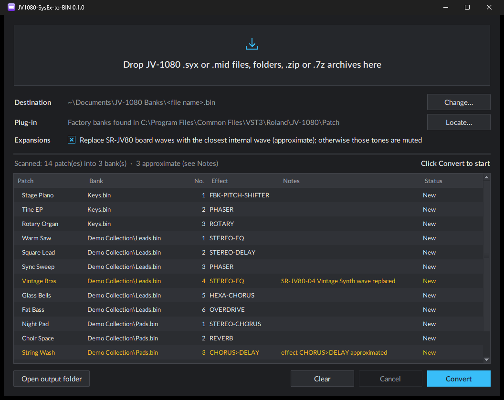

<p align="center"></p>

<h1 align="center">JV1080-SysEx-to-BIN</h1>

<p align="center">Turn Roland JV-1080 patch dumps (<code>.syx</code> / <code>.mid</code>) into banks for the
Roland Cloud JV-1080 plug-in: drag, drop, load.</p>

<p align="center"></p>

## Why

The JV-1080 plug-in only loads its own bank files (`.bin`); it cannot read the SysEx dumps made
with the hardware JV-1080, JV-2080 or XP series, which is how thousands of patches have been shared
since the 1990s. This tool converts them.

## Features

- **SysEx and MIDI files**: `.syx` dumps and Standard MIDI Files (`.mid`) holding JV-1080 patches,
  as sent by the JV-1080, JV-2080, JV-1010 and XP-50 / 60 / 80 (user, card and temporary patches).
- **Drag and drop**: files, folders, `.zip` and `.7z` archives (unpacked automatically), several at once.
- **Scan first**: see every patch with its effect and conversion notes, and which banks will be
  created or replaced, then confirm with **Convert**.
- **One bank per file**: each dump becomes a 128-patch bank named after it; empty slots get an
  INIT patch, dumps with more than 128 patches give several banks.
- **Faithful**: factory patches converted from SysEx sound the same as the plug-in's own presets
  (checked on the factory Preset D bank).
- **Expansion boards**: patches made for the 19 SR-JV80 boards (Pop, Orchestral, Vintage Synth,
  World, Dance...) use waves the plug-in does not have. By default those waves are replaced with the closest internal wave and
  the patch is marked *approximate*; untick the option to mute those tones instead.
- **Safe re-runs**: converting again replaces the earlier banks and never touches files you added.

## Download

Get `JV1080-SysEx-to-BIN-<version>-windows-x64.zip` from the [**Releases**](../../releases/latest)
page, unzip it anywhere and run `JV1080-SysEx-to-BIN.exe`. No installation needed. Windows 10 or 11
(64-bit), with the Roland Cloud JV-1080 plug-in installed: the converter builds on the plug-in's
own factory banks, so no Roland data ships with it.

> Windows SmartScreen may warn about an unrecognised app the first time, because the executable
> is not code-signed: click **More info → Run anyway**.

## Usage

1. Start `JV1080-SysEx-to-BIN.exe`.
2. Drop `.syx` / `.mid` files, folders or `.zip` / `.7z` archives on the window (or on the `.exe`
   icon, or click the drop zone to browse).
3. Check the scan: patch names, effects, notes. Nothing has been written yet.
4. Click **Convert** (or press Enter).
5. In the plug-in, click **BANK**, then **LOAD**, and choose the new `.bin` file.

Output (default destination: `Documents\JV-1080 Banks`, changeable with **Change…**; the choice is
remembered):

```
JV-1080 Banks\
├── My Leads.bin          ← from "My Leads.syx"
└── Collection\           ← a dropped folder or archive keeps its layout
    ├── Pads.bin
    └── Keys\Pianos.bin
```

If the plug-in was installed somewhere unusual, click **Locate…** and choose its `Patch` folder
(the one holding `PR-A.bin`).

## What gets converted

| | |
|---|---|
| Patch common, 4 tones, envelopes, LFOs, filters, key / velocity ranges, structures | ✓ |
| Waveforms (INT-A, INT-B) | ✓ mapped to the plug-in's XV-5080 wave list |
| Controllers (modulation, control sources 2 and 3) | ✓ as matrix controls |
| Chorus, reverb | ✓ |
| EFX | ✓ 40 types; 3 parallel ones become serial, 15 rarely used ones are approximate |
| SR-JV80 expansion waves | approximate (closest internal wave) or muted; all 19 boards |
| PCM card (SN-U110) waves | muted |
| Rhythm sets, performances | no: patches only |
| Patch category | not set (the JV-1080 has none) |

The notes column says what was approximated for each patch.

## Command line

```
JV1080-SysEx-to-BIN.exe --cli PATH... [--out DIR] [--mute-expansion] [--plugin DIR]
```

Converts without opening the window. `--mute-expansion` silences expansion-board waves instead of
replacing them; `--plugin` gives the folder of the plug-in's factory banks.

## Run or build from source

Requires Python 3.12+ on Windows.

```
py -m pip install -r requirements.txt
py -m jv1080_sysex_to_bin               # the window
py -m unittest discover -s tests -v     # tests (they build their own synthetic dumps)

py -m pip install -r requirements-build.txt
py build.py                             # dist\JV1080-SysEx-to-BIN.exe + release .zip
```

Pushing a version tag (`v1.2.3`) makes GitHub Actions run the tests, build the `.exe` and attach
it to the release (see `.github/workflows/build.yml`).

## How it works

The plug-in stores XV-5080 style patches (23,255 bytes each). The layout, the wave list mapping
and every value conversion were worked out by comparing factory patches available both as
JV-1080 SysEx and in the plug-in's factory banks, with the JV-1080 and XV-5080 owner's manuals.
See [`docs/FORMAT.md`](docs/FORMAT.md).

## Credits

Inspired by [JDTools](https://github.com/sagamusix/JDTools) by Johannes Schultz, which does the same
for the JD-800 plug-in. No code is shared: the JV-1080 plug-in uses a different format.

## Notes

- Please only convert patches you are allowed to use; many commercial banks have their own licence.
- Roland, JV-1080, XV-5080 and Roland Cloud are trademarks of Roland Corporation. This project is
  not affiliated with or endorsed by Roland.

## Licence

[MIT](LICENSE)
